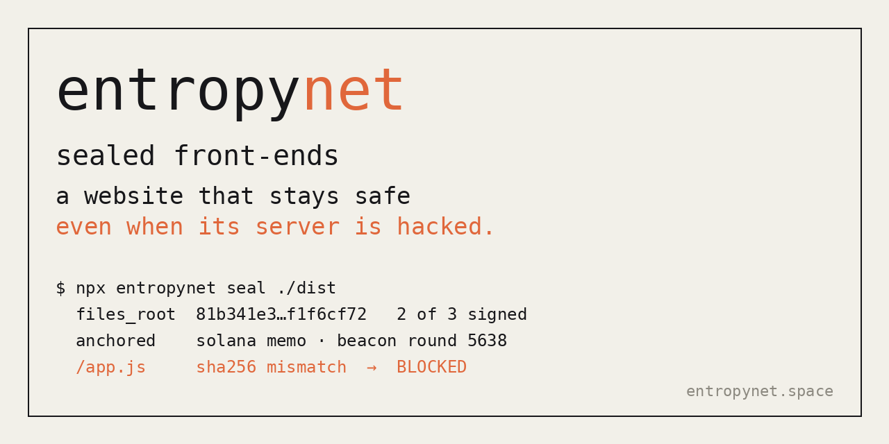

# entropynet

Public randomness every 3 seconds on Solana, and launches nobody can snipe.

Live: https://entropynet.space

## What it does
- **Beacon.** Every 3 seconds, five nodes reveal secrets they committed to one round earlier. The beacon mixes the reveals with a finalized Solana block hash, links the result to the previous round and signs it with ed25519.
- **Verifier.** The site re-checks any round in your browser: commits, mix, randomness, signature and chain.
- **Fair launches.** The creator picks a window. The first round after the window opens picks the exact launch second. An optional first-buy raffle is drawn by the round at that second. Every launch gets a public entropy receipt.

Launches run in paper mode (`ENTROPY_LAUNCHES_LIVE=false`). Nothing is sent on-chain.

## API
| | |
|---|---|
| `GET /api/round/latest` | newest round |
| `GET /api/round/:n` | one round (immutable) |
| `GET /api/round/info` | public key, period, genesis, message format |
| `GET /api/launch` | launch board |
| `GET /api/launch/:id` | one launch and its receipt |

Beacon public key: `b1f6a5c337b97f1b2a0f986b22611f6761e14b3d57e11d52e5e2e3e81974fb14`

Full spec: [docs/SPEC.md](docs/SPEC.md)

## Run it
Static site in `public/`, Vercel functions in `api/`, rounds stored in Vercel Blob. Copy `.env.example`, fill it in, then `vercel dev`.

## CI
A GitHub Actions workflow is included as `docs/ci.yml.example`. To turn it on, copy it to `.github/workflows/ci.yml` and push (pushing workflows needs a token with the `workflow` scope, or add it from GitHub's web editor). It runs `npm ci`, a syntax check and `scripts/check.mjs`, which signs and verifies a test round.

## License
MIT
